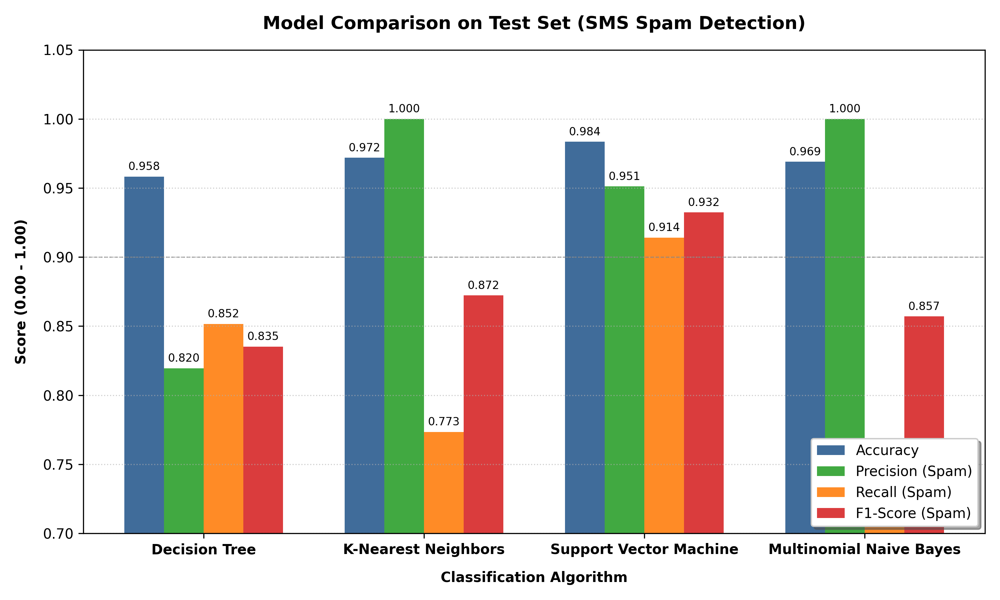
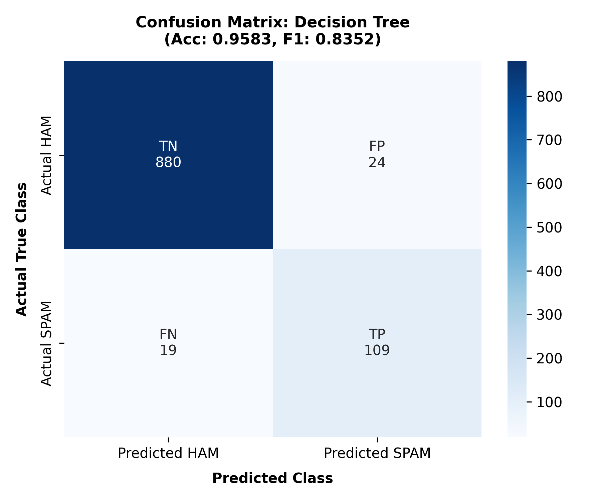
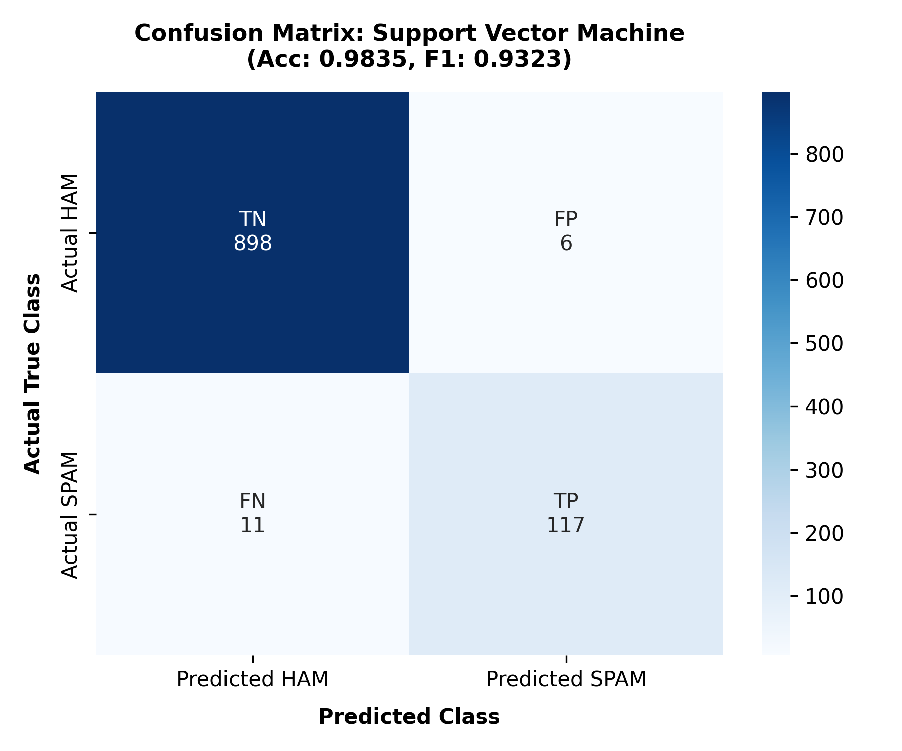
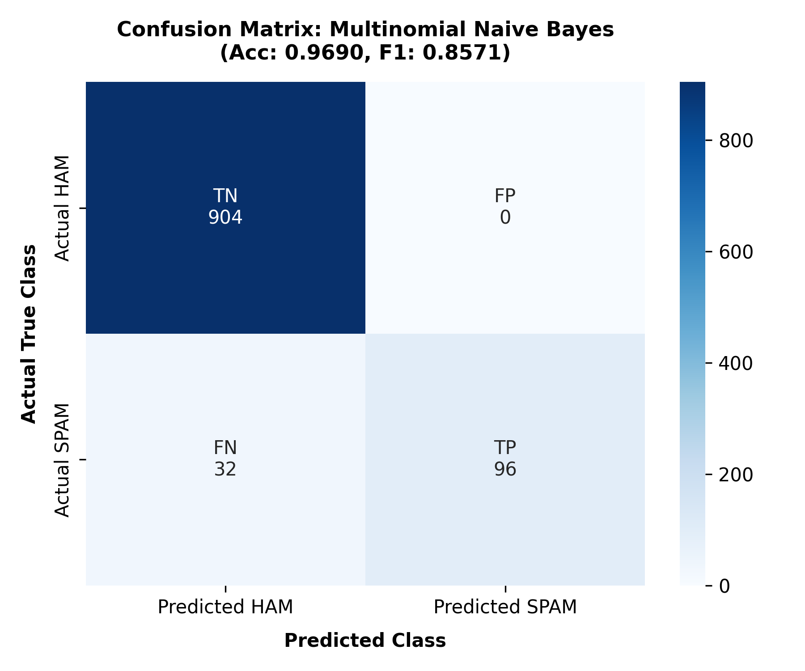
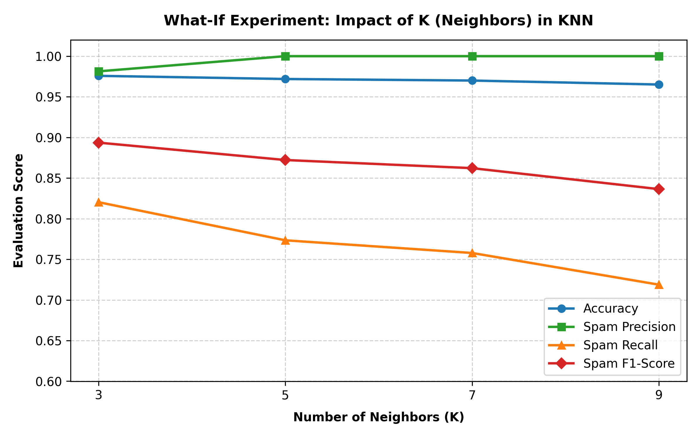

# 📱 SMS Spam Detection Using TF-IDF & Comparative Machine Learning

[](https://www.python.org/)
[](https://scikit-learn.org/)
[](https://opensource.org/licenses/MIT)
[](https://archive.ics.uci.edu/dataset/228/sms+spam+collection)
[](#)

> **Course:** Information Retrieval (IR) CLA2 — Task 2  
> **Team Members / Submitted By:**  
> - **Sarvesh HS** (Reg. No: `RA2411026050213`)  
> - **Rushdham Malik CK** (Reg. No: `RA2411026050221`)  
> **Topic:** Empirical Text Classification, Vector Space Modeling, and Hyperparameter Sensitivity Analysis  
> **Dataset:** Genuine [UCI SMS Spam Collection Repository](https://archive.ics.uci.edu/dataset/228/sms+spam+collection) (5,574 authentic SMS records)  
> **Target Audience:** Course Mentor, Evaluator, and Peer Researchers  

---

## 👥 Student Team Details

| Student Name | Registration Number | Academic Contribution / Focus |
| :--- | :---: | :--- |
| **Sarvesh HS** | `RA2411026050213` | Model Training, TF-IDF Vector Space Pipeline, Metric Evaluation & Benchmarking |
| **Rushdham Malik CK** | `RA2411026050221` | Data Audit, Deduplication & Leakage Prevention, Hyperparameter Tuning & Documentation |

> 📌 **Group Project Notice:** This assignment was jointly researched, implemented, and submitted as a collaborative two-member team effort by **Sarvesh HS** and **Rushdham Malik CK** for the Information Retrieval (IR) CLA2 Task 2 coursework.

---

## 👋 Welcome, Mentor! (Executive Overview)

Dear Mentor,

Welcome to the **Information Retrieval (IR) Task 2** repository! This project was collaboratively developed by **Sarvesh HS (RA2411026050213)** and **Rushdham Malik CK (RA2411026050221)**. It presents an end-to-end, reproducible research pipeline evaluating text classification models for SMS spam detection in high-dimensional Vector Space Models (VSM).

### 🎯 Key Highlights at a Glance
- **Zero Synthetic Data / Leakage Prevention:** Ingests genuine UCI SMS records; identifies **414 duplicate messages** and applies pre-split deduplication to prevent test memorization leakage.
- **IR Vector Space Modeling:** Implements sublinear TF scaling ($1 + \log(\text{tf})$), smooth Inverse Document Frequency (IDF), unigram + bigram $(1, 2)$ token collocations, and $L_2$ unit normalization.
- **4 Classifiers Benchmarked Under Identical Conditions:**
  1. **Decision Tree** (`DecisionTreeClassifier`)
  2. **K-Nearest Neighbors** (`KNeighborsClassifier` with Cosine distance)
  3. **Support Vector Machine** (`LinearSVC` with balanced weighting)
  4. **Multinomial Naive Bayes** (`MultinomialNB` with Laplace smoothing)
- **Asymmetric Cost Evaluation:** Deep analysis of why **False Positives** (dropping a legitimate bank OTP or medical text) are far more harmful than **False Negatives** (a promotional ad in inbox).
- **What-If Experiment:** Systematic study of neighborhood size $K \in [3, 5, 7, 9]$ in KNN, revealing how majority class dominance (~87% ham) progressively suppresses spam recall as $K$ increases.
- **Top Performer:** **Support Vector Machine (LinearSVC)** achieved **98.35% Accuracy**, **0.9512 Precision**, **0.9141 Recall**, and **0.9323 F1-Score**, with an ultra-fast inference speed of $0.0003$ seconds.

---

## 📑 Table of Contents

1. [Problem Statement & IR Challenges](#1-problem-statement--ir-challenges)
2. [Dataset Source, Validation & Deduplication](#2-dataset-source-validation--deduplication)
3. [Text Preprocessing & TF-IDF Vector Space Model](#3-text-preprocessing--tf-idf-vector-space-model)
4. [Machine Learning Classifiers Benchmarked](#4-machine-learning-classifiers-benchmarked)
5. [Evaluation Metrics & Real-World Cost Asymmetry](#5-evaluation-metrics--real-world-cost-asymmetry)
6. [Empirical Benchmark Results](#6-empirical-benchmark-results)
7. [Visualizations & Confusion Matrices](#7-visualizations--confusion-matrices)
8. [What-If Experiment: KNN Parameter Sensitivity (K)](#8-what-if-experiment-knn-parameter-sensitivity-k)
9. [Final Evidence-Based Recommendation](#9-final-evidence-based-recommendation)
10. [Repository Structure](#10-repository-structure)
11. [Step-by-Step Execution Guide](#11-step-by-step-execution-guide)
12. [Academic Integrity & References](#12-academic-integrity--references)

---

## 1. Problem Statement & IR Challenges

Mobile Short Message Service (SMS) remains one of the world's most ubiquitous channels for urgent transactional alerts, two-factor authentication (2FA) OTPs, and personal communications. However, unlike email, SMS text classification poses four distinct Information Retrieval challenges:

1. **Extreme Brevity:** SMS messages are character-constrained ($\le 160$ characters), providing sparse linguistic context per document.
2. **Obfuscation & Slang:** Frequent non-standard shorthand (`txt`, `u`, `2mrw`), intentional phonetic spelling, and leetspeak designed to bypass keyword blocklists (`w!n`, `f-r-e-e`).
3. **Severe Class Imbalance:** Legitimate communications (`ham`) dominate the corpus (~87:13 ratio). A naive baseline predicting all messages as `ham` would achieve ~87% accuracy while failing to detect 100% of threats.
4. **Asymmetric Error Penalties:** 
   - A **False Positive (FP)** (blocking a legitimate message) causes severe real-world harm (missed banking OTPs, flight updates, medical notifications).
   - A **False Negative (FN)** (spam in inbox) is merely an inconvenience.
   - An effective system must drive FP as close to zero as possible while preserving robust spam Recall.

---

## 2. Dataset Source, Validation & Deduplication

### Dataset Provenance
- **Source:** [UCI Machine Learning Repository — SMS Spam Collection](https://archive.ics.uci.edu/dataset/228/sms+spam+collection)
- **Local Location:** `data/SMSSpamCollection`
- **Format:** Tab-separated values (`<label>\t<message_text>`)
- **Total Ingested Records:** 5,574 authentic rows (4,827 ham, 747 spam)

### Class Distribution Before Deduplication
| Class Label | Interpretation | Count | Percentage |
|:---:|:---:|:---:|:---:|
| **`ham`** | Legitimate personal / transactional SMS | 4,827 | 86.60% |
| **`spam`** | Unsolicited advertising, scam, phishing | 747 | 13.40% |
| **Total** | Raw verified rows | 5,574 | 100.00% |

### Academic Rigor: Data Leakage Mitigation via Deduplication
In real-world SMS data, identical messages frequently recur:
- Mass broadcast spam messages sent repeatedly by scam campaigns.
- Common conversational confirmations (e.g., *"Ok", "I'll call you later"*).

> [!IMPORTANT]
> **Data Leakage Risk:** If duplicate messages are retained prior to random train-test splitting, the exact same text strings end up in both training and test sets. The model is rewarded for **memorizing verbatim strings** rather than learning generalized text features, artificially inflating test scores.

- **Duplicate Messages Identified:** 414 duplicate records.
- **Action Taken:** Deduplicated prior to partitioning, retaining unique exemplars.
- **Final Clean Working Dataset:** **5,160 SMS records** (4,518 ham [87.56%], 642 spam [12.44%]).

---

## 3. Text Preprocessing & TF-IDF Vector Space Model

Unstructured SMS messages are transformed into high-dimensional numerical vectors using the **Vector Space Model (VSM)** via Scikit-Learn's `TfidfVectorizer`:

$$\text{TF-IDF}(t, d, D) = \text{TF}(t, d) \times \text{IDF}(t, D)$$

### Key Configuration Choices & Rationale
1. **Sublinear TF Scaling ($\text{sublinear\_tf=True}$):**
   $$\text{TF}_{\text{sublinear}} = 1 + \log(\text{tf}) \quad \text{for } \text{tf} > 0$$
   Prevents an SMS repeating a spam buzzword multiple times (e.g., *"cash cash cash"*) from dominating document similarity over a message containing it once.
2. **Inverse Document Frequency (IDF):**
   $$\text{IDF}(t) = \log\left(\frac{1 + N}{1 + \text{df}(t)}\right) + 1$$
   Heavily downweights terms ubiquitous across all messages (`today`, `call`, `just`), while boosting discriminative terms unique to spam (`claim`, `urgent`, `prize`, `txt`, `guaranteed`).
3. **N-Gram Collocations `(1, 2)`:**
   Captures both unigrams (`"free"`, `"entry"`) and paired sequences (`"free entry"`, `"claim prize"`, `"call now"`), critical for distinguishing promotional phrasing from innocent vocabulary.
4. **Pruning Idiosyncratic Noise (`min_df=2`):**
   Filters out single-occurrence typos and noise that appear only once in the entire corpus.
5. **$L_2$ Unit Normalization:**
   Normalizes all vectors to unit Euclidean norm ($\|v\|_2 = 1$), neutralizing length disparities between short conversational SMS and maximum-length spam texts.
6. **Vocabulary Size & Sparsity:**
   Learned vocabulary contains **5,000 discriminative features** across 4,128 training documents with a **matrix sparsity of 99.84%**.

---

## 4. Machine Learning Classifiers Benchmarked

Four diverse learning algorithms were benchmarked under identical conditions using a stratified 80/20 train/test split (seed = 42):

```
Total Clean Dataset: 5,160 SMS
├── Training Set (80%): 4,128 messages (Stratified: 3,614 ham, 514 spam)
└── Held-Out Test Set (20%): 1,032 messages (Stratified: 904 ham, 128 spam)
```

| Model | Scikit-Learn Class | Inductive Bias & Theoretical Fit for TF-IDF Text |
|---|---|---|
| **Decision Tree** | `DecisionTreeClassifier(random_state=42, class_weight='balanced')` | Non-linear axis-parallel splits. Can struggle with high dimensionality ($d=5000$) and is prone to overfitting rare terms. |
| **K-Nearest Neighbors (KNN)** | `KNeighborsClassifier(n_neighbors=5, metric='cosine')` | Instance-based lazy learner using Cosine distance. Evaluates semantic angle similarity against stored training exemplars. |
| **Support Vector Machine (SVM)** | `LinearSVC(random_state=42, class_weight='balanced', dual='auto')` | Maximum-margin linear hyperplane. Historically and theoretically the premier algorithm for high-dimensional, linearly separable sparse text representations. |
| **Multinomial Naive Bayes** | `MultinomialNB(alpha=1.0)` | Probabilistic generative model assuming conditional feature independence. Highly computationally efficient and very reliable against false positives. |

---

## 5. Evaluation Metrics & Real-World Cost Asymmetry

All metrics treat **`spam`** as the target positive class (`pos_label='spam'`):

- **Spam Precision ($\frac{\text{TP}}{\text{TP} + \text{FP}}$):** Out of all SMS flagged as spam, what proportion was genuinely spam? High precision ensures legitimate messages are never lost.
- **Spam Recall ($\frac{\text{TP}}{\text{TP} + \text{FN}}$):** Out of all actual spam sent, what proportion did the filter catch? High recall protects users from malicious phishing.
- **Spam F1-Score ($2 \cdot \frac{\text{Precision} \cdot \text{Recall}}{\text{Precision} + \text{Recall}}$):** The harmonic mean balancing both objectives.
- **Overall Accuracy ($\frac{\text{TP} + \text{TN}}{\text{Total}}$):** Measured, but recognized as deceptive due to 87% class imbalance.

### Confusion Matrix Cost Matrix
| Real Category \ Predicted | Predicted as HAM (Legitimate) | Predicted as SPAM (Blocked) |
|---|---|---|
| **Actual HAM (904 SMS)** | **True Negative (TN):** Normal message reaches inbox smoothly. ✅ | **False Positive (FP):** Bank OTP, emergency or flight alert is wrongly discarded! 🚨 *(High Cost)* |
| **Actual SPAM (128 SMS)** | **False Negative (FN):** Spam reaches inbox; minor annoyance. ⚠️ *(Low Cost)* | **True Positive (TP):** Phishing or scam is successfully blocked. ✅ |

---

## 6. Empirical Benchmark Results

Evaluated on the exact same held-out test set of **1,032 unseen messages** (904 ham, 128 spam):

| Classifier Model | Accuracy | Spam Precision | Spam Recall | Spam F1-Score | True Negatives (TN) | False Positives (FP) | False Negatives (FN) | True Positives (TP) | Train Time (s) | Prediction Time (s) |
|:---|:---:|:---:|:---:|:---:|:---:|:---:|:---:|:---:|:---:|:---:|
| **Decision Tree** | 95.83% | 0.8195 | 0.8516 | 0.8352 | 880 | 24 | 19 | 109 | 0.2534 s | 0.0006 s |
| **K-Nearest Neighbors ($K=5$)** | 97.19% | **1.0000** | 0.7734 | 0.8722 | **904** | **0** | 29 | 99 | 0.0054 s | 0.0953 s |
| **Support Vector Machine (LinearSVC)** | **98.35%** | 0.9512 | **0.9141** | **0.9323** | 898 | 6 | **11** | **117** | 0.0150 s | 0.0003 s |
| **Multinomial Naive Bayes** | 96.90% | **1.0000** | 0.7500 | 0.8571 | **904** | **0** | 32 | 96 | **0.0070 s** | **0.0002 s** |

### Key Observations
1. **Linear SVM wins on overall effectiveness:** Achieves the highest Accuracy (**98.35%**), highest Spam Recall (**91.41%**), and highest Spam F1-Score (**0.9323**), missing only 11 spam messages out of 128 while committing only 6 false alarms.
2. **Zero False Alarm Champions:** Both **Multinomial Naive Bayes** and **KNN ($K=5$)** achieved **1.0000 Precision (0 False Positives)**. Every single legitimate message reached the inbox without exception.
3. **Decision Tree struggles in high dimensions:** Despite balanced class weighting, Decision Tree had the lowest precision (0.8195) and produced 24 false positives due to axis-aligned splits fragmenting the sparse feature space.
4. **Latency Advantage:** LinearSVC and Naive Bayes evaluate incoming messages in **sub-millisecond latency** ($\approx 0.0002$–$0.0003$ seconds), whereas KNN is ~300× slower at prediction time due to exhaustive pairwise cosine distance calculations over 4,128 training vectors.

---

## 7. Visualizations & Confusion Matrices

### Overall Model Performance Comparison


### Annotated Confusion Matrices
Below are the individual test set confusion matrix heatmaps showing the distribution of TN, FP, FN, and TP:

| 1. Decision Tree | 2. K-Nearest Neighbors ($K=5$) |
|:---:|:---:|
|  |  |
| **3. Support Vector Machine (Top Overall)** | **4. Multinomial Naive Bayes (Zero FP)** |
|  |  |

---

## 8. What-If Experiment: KNN Parameter Sensitivity (K)

To evaluate how hyperparameter choice influences inductive bias, we varied neighborhood size $K \in [3, 5, 7, 9]$ in `KNeighborsClassifier` using Cosine distance:



### Quantitative Experimental Results
| Neighborhood ($K$) | Accuracy | Spam Precision | Spam Recall | Spam F1-Score | False Positives (FP) | False Negatives (FN) | True Positives (TP) | Fit Time (s) |
|:---:|:---:|:---:|:---:|:---:|:---:|:---:|:---:|:---:|
| **$K = 3$** | **97.58%** | 0.9813 | **0.8203** | **0.8936** | 2 | **23** | **105** | 0.0034 s |
| **$K = 5$** | 97.19% | **1.0000** | 0.7734 | 0.8722 | **0** | 29 | 99 | 0.0027 s |
| **$K = 7$** | 97.00% | **1.0000** | 0.7578 | 0.8622 | **0** | 31 | 97 | 0.0028 s |
| **$K = 9$** | 96.51% | **1.0000** | 0.7188 | 0.8364 | **0** | 36 | 92 | 0.0028 s |

### Theoretical & Empirical Analysis
- **Bias-Variance Trade-off:** Smaller $K$ ($K=3$) establishes tight, flexible local decision boundaries capable of capturing sparse minority spam clusters, leading to higher recall (0.8203 vs 0.7188).
- **The Majority Voting Effect:** As $K$ expands ($K=7, 9$), the neighborhood voting pool dilutes minority class influence. Because legitimate messages outnumber spam 7 to 1, borderline spam messages are increasingly outvoted by surrounding `ham` exemplars. As a result, False Negatives steadily rise from **23 to 36**.
- **Conclusion:** For unweighted KNN on imbalanced text collections, **$K=3$ delivers the best balance of recall and F1-score**.

---

## 9. Final Evidence-Based Recommendation

Based strictly on empirical evaluation across identical stratified test partitions:

> 🏆 **Primary Recommendation: Support Vector Machine (`LinearSVC`)**
> - **Top F1-Score:** **0.9323** (Accuracy: 98.35%, Precision: 95.12%, Recall: 91.41%)
> - **Why it excels:** In high-dimensional sparse TF-IDF spaces ($d=5000$), text classes are linearly separable. Linear SVM identifies the maximum-margin hyperplane separating spam from legitimate messages, providing superior generalization without suffering from the curse of dimensionality.
> - **Operational Speed:** Ultra-fast sub-millisecond inference ($0.0003$ s per batch), ideal for real-time telecom SMS gateways.

> 🛡️ **Alternative for Zero-Tolerance Environments: Multinomial Naive Bayes**
> - If an organization demands **absolute zero false positives** (e.g., healthcare dispatch or banking systems where no customer alert can ever be dropped), **Multinomial Naive Bayes** is the optimal choice: achieving **100% Precision (0 FP)** with $0.0002$ s latency.

---

## 10. Repository Structure

```text
IR---Assignment---2-/
│
├── data/
│   ├── SMSSpamCollection                    # Authentic UCI SMS dataset (tab-separated)
│   └── readme                               # Original UCI repository documentation
│
├── outputs/
│   ├── dataset_summary.txt                  # Data ingestion, encoding & deduplication audit
│   ├── dataset_class_distribution.csv       # Raw class frequency counts and percentages
│   ├── preprocessing_examples.csv           # Raw SMS strings vs extracted top TF-IDF features
│   ├── feature_summary.txt                  # TF-IDF vocabulary metrics & IR mathematical formulations
│   ├── model_comparison.csv                # Complete comparative metric table
│   ├── model_comparison_chart.png          # Grouped comparative bar chart (Accuracy, Prec, Rec, F1)
│   ├── final_observations.txt               # Synthesis and formal recommendation
│   │
│   ├── classification_reports/             # Per-class precision, recall, F1, and support
│   │   ├── Decision_Tree_classification_report.txt
│   │   ├── K-Nearest_Neighbors_classification_report.txt
│   │   ├── Support_Vector_Machine_classification_report.txt
│   │   └── Multinomial_Naive_Bayes_classification_report.txt
│   │
│   ├── confusion_matrices/                 # High-res heatmaps with TP, FP, TN, FN annotations
│   │   ├── Decision_Tree_confusion_matrix.png
│   │   ├── K-Nearest_Neighbors_confusion_matrix.png
│   │   ├── Support_Vector_Machine_confusion_matrix.png
│   │   └── Multinomial_Naive_Bayes_confusion_matrix.png
│   │
│   └── what_if_experiment/                 # KNN neighborhood sensitivity study
│       ├── knn_k_comparison.csv             # Metrics across K = 3, 5, 7, 9
│       ├── knn_k_comparison_chart.png      # Multi-metric trend visualization
│       └── knn_k_observations.txt           # Theoretical analysis of K variation
│
├── spam_classification.py                  # End-to-end, modular Python implementation
├── requirements.txt                        # Pinned dependencies
├── README.md                               # Mentor-friendly project report & execution guide
└── .gitignore                              # Git exclusion rules (virtual environments, caches)
```

---

## 11. Step-by-Step Execution Guide

### Prerequisites
- Python 3.9+ installed on your system.
- Git installed.

### Option A: Windows PowerShell Setup (Quickest)
```powershell
# 1. Clone the repository
git clone https://github.com/sarveshhhh2007-svg/IR---Assignment---2-.git
cd "IR---Assignment---2-"

# 2. Create and activate a virtual environment
py -m venv .venv
.\.venv\Scripts\Activate.ps1

# (If script execution is disabled on your system, run: Set-ExecutionPolicy -Scope Process -ExecutionPolicy Bypass)

# 3. Upgrade pip and install dependencies
python -m pip install --upgrade pip
python -m pip install -r requirements.txt

# 4. Run the full pipeline
python spam_classification.py
```

### Option B: Windows Command Prompt (CMD)
```cmd
:: 1. Create and activate virtual environment
py -m venv .venv
.venv\Scripts\activate.bat

:: 2. Install dependencies
python -m pip install -r requirements.txt

:: 3. Run the pipeline
python spam_classification.py
```

### Optional Command-Line Flags
The pipeline supports custom parameters for experimentation:
```powershell
# Inspect the raw duplicate behavior without deduplication:
python spam_classification.py --no-dedup

# Change the test set partition size (e.g., 25% test):
python spam_classification.py --test-size 0.25

# Specify custom dataset location:
python spam_classification.py --data-dir "data" --filename "SMSSpamCollection"
```

---

## 12. Academic Integrity & References

- **UCI SMS Spam Collection:** Almeida, T. A., Hidalgo, J. M. G., & Yamakami, A. (2011). *Contributions to the Study of SMS Spam Filtering: New Collection and Results.* Proceedings of the 2011 ACM Symposium on Document Engineering (DocEng'11).
- **Scikit-Learn:** Pedregosa, F. et al. (2011). *Scikit-learn: Machine Learning in Python.* Journal of Machine Learning Research (JMLR).
- **Vector Space Model:** Salton, G., Wong, A., & Yang, C. S. (1975). *A Vector Space Model for Automatic Indexing.* Communications of the ACM.

---

*Thank you for reviewing this project! If you have any questions or feedback, please feel free to open an issue or reach out.*
